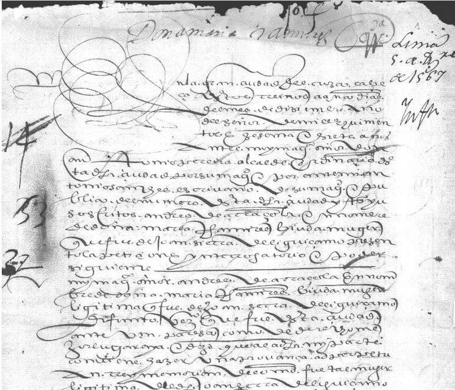
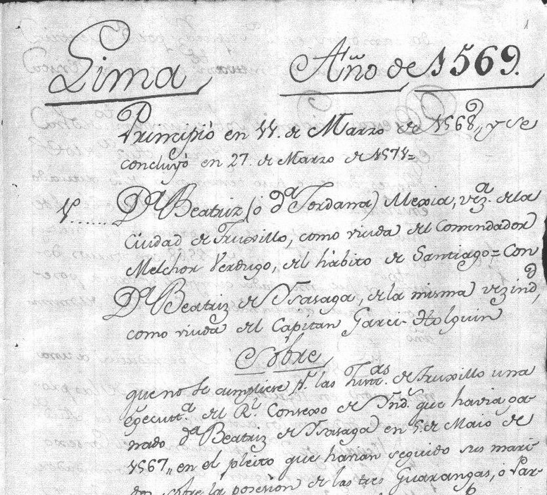
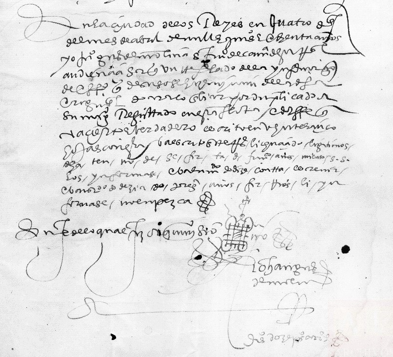
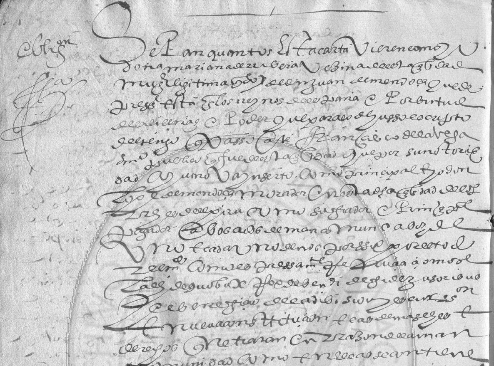
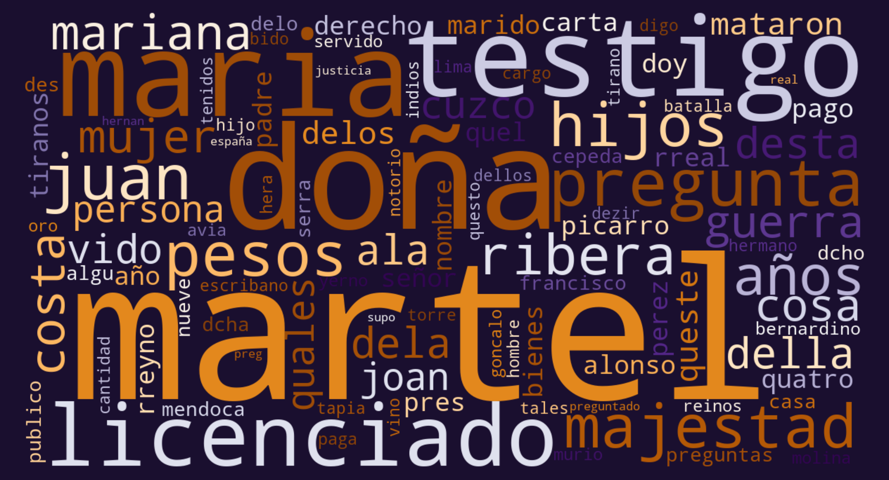
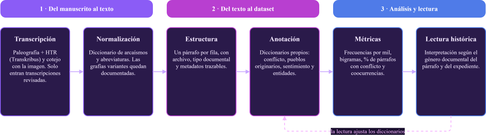
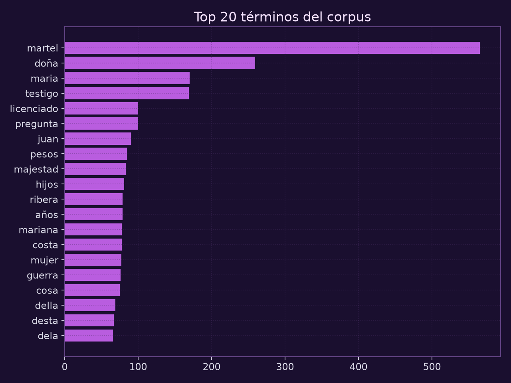
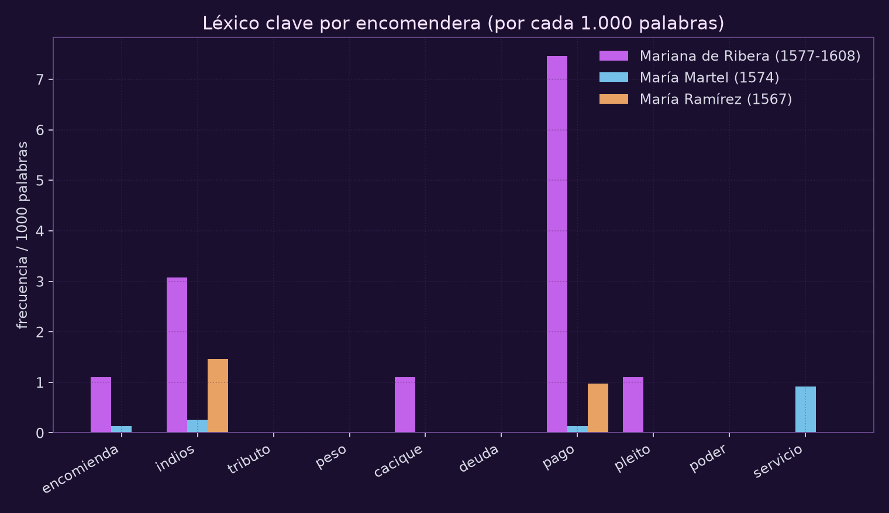
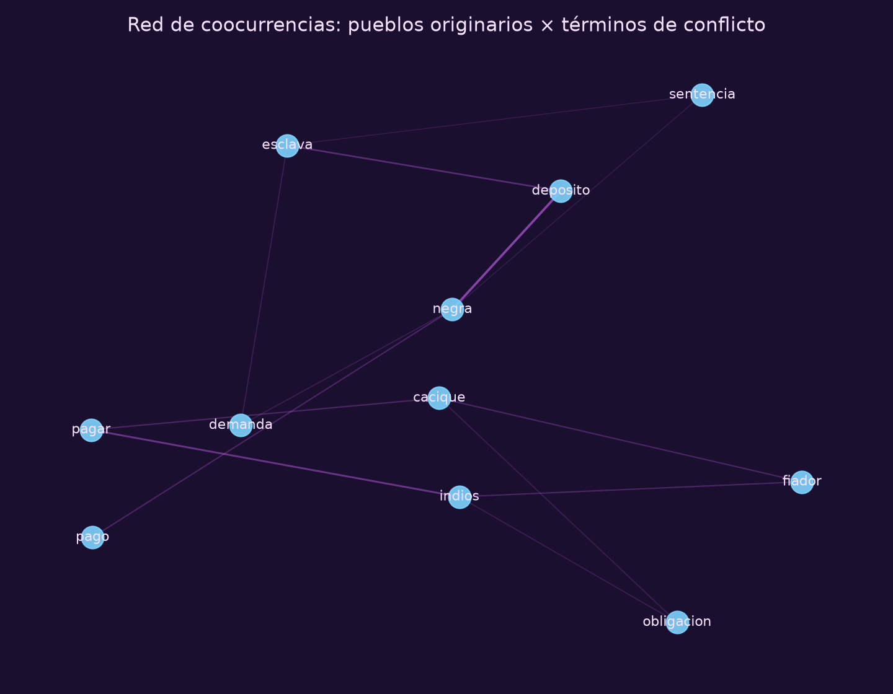

## Voces veladas: Mujeres, Humanidades Digitales y el archivo colonial en los albores del Virreinato del Perú (siglo XVI)

#### Avances de investigación

##### [Romina De León](mailto:romideleon@gmail.com)

  
  

---

## 1. La paradoja estructural del poder femenino en el Virreinato del Perú

¿Cómo ejerce autoridad **quien ocupa, simultáneamente, una posición de subordinación y una de dominio sociorracial**?

<ul>
  <li><b>Subordinadas</b>: bajo la tutela legal de padres, maridos o albaceas (M. E. Mannarelli).</li>
  <li><b>Dominantes</b>: controlaban el trabajo, el tributo y los cuerpos de pueblos encomendados y personas esclavizadas.</li>
</ul>

  

  <a href="https://es.wikipedia.org/wiki/Elvira_de_Mendoza" data-lightbox="docs"> <em>Antecedente empírico: Ediciones digitales y anotación manual de entidades. Reveló la "triangulación legal" de Elvira Manrique de Chaves a través de mediadores varones.</em></a>

  <a href="https://upload.wikimedia.org/wikipedia/commons/0/04/Criollos-Espa%C3%B1oles_Per%C3%ACodo_Colonial_en_Am%C3%A9rica_(cropped)1.jpg" data-lightbox="docs"> 
    
    <em>Criollos y españoles en la sociedad estamental.   Dibujo de la crónica peruana de Felipe Guamán Poma de Ayala, siglo XVI.</em></a>

  

  <a href="https://www.memoriachilena.gob.cl/602/articles-100512_thumbnail.jpg" data-lightbox="docs">
    
    <em>El corregidor de minas castiga cruelmente a los caciques principales.  Felipe Guamán Poma de Ayala (1615).</em></a>
  

---

## 2. Archivo y recorte

- Archivo General de Indias
- Fondo Documental del Archivo General de la Nación del Perú - Archivo Histórico Digital del Archivo General de la Nación
- Archivo y Biblioteca Nacionales de Bolivia
- Censos (Aún no encontré y tampoco estoy segura si será relevante)
- Cartas y peticiones (Igual que el anterior)

**Tipos de fuentes**: Probanzas de bienes y servicios; Testamentos, bienes de difuntos; Expedientes judiciales; protocolos notariales de Lima (pagos, obligaciones, depósitos, poderes) — la fase de consolidación y disputa de la **perpetuidad** de la encomienda (1560–1620).

**Recorte temporal y geográfico**
Siglos XVI y principios del XVII, núcleo andino (Audiencias de Lima y Charcas), con **proyección comparada hacia el sur del Virreinato** (Tucumán, Paraguay, Córdoba), donde la encomienda tuvo mutaciones.

--

##### Fragmentos del archivo colonial

  

  

  

  

  

---

## 3. Del manuscrito al dataset

- Paleografía manual + **HTR con Transkribus** + cotejo con la imagen.
- Se excluyen las transcripciones sin revisar: **la calidad de los datos es parte del método**.
- `docx → txt` → tibble ordenado **párrafo por párrafo**, con metadatos trazables.
- A través del paradigma de la minimal computing, habilita el uso de herramientas abiertas de bajo costo, formato real portable y reproducible — coherente con las infraestructuras académicas de la región.

--

##### Primeros números

- <b>6.316</b> párrafos anotados
- <b>23.823</b> tokens · <b>6.941</b> formas únicas
- <b>19</b> documentos · <b>4</b> encomenderas
- Cada párrafo conserva su tipo documental, marcadores de conflicto, sentimiento y entidades.

--

##### Flujo de trabajo

  

---

## 4. Normalizar el español del siglo XVI

[f3] mancomunidad obligamos nuestras perssonas e bienes sa[bidos¿] e por aver e damos poder a las justicias de su Majestad para su execuçion e [cumplimiento??] ... e por la <b>dha doña Mariana de Rribera</b> e rrenunçia al benefi- cio [?feliano..?]

→ mancomunidad obligamos perssonas bienes sabidos aver damos justicias majestad execucion ... doña mariana ribera rrenuncia ...

--

- Diccionario de **arcaísmos y abreviaturas notariales** (fazer→hacer, dha→dicha, ſ→s, ç→c) y expansiones de los corchetes editoriales de Transkribus (`[...]` lectura confirmada, `[...¿?]` lectura dudosa).
- Límite honesto: la transcripción no es una operación **neutral ni meramente técnica** — exige decisiones exegéticas rigurosas. Las grafías inestables (_rrenuncia_) y la ortografía variable (_Bernardino / Bernaldino_) quedan documentadas, no silenciadas.

---

## 5. Frecuencias y cadenas de nominación

<h3>Top 20</h3>
<ul style="font-size: 0.90rem !important; padding-left: 20px; margin-top: 5px;">
    <li style="font-size: inherit;"><b>martel</b> (565)</li>
    <li style="font-size: inherit;">doña (259)</li>
    <li style="font-size: inherit;">maría (170)</li>
    <li style="font-size: inherit;"><b>testigo</b> (169)</li>
    <li style="font-size: inherit;">licenciado (100)</li>
    <li style="font-size: inherit;"><b>pregunta</b> (100)</li>
    <li style="font-size: inherit;">pesos (85)</li>
    <li style="font-size: inherit;">majestad (83)</li>
    <li style="font-size: inherit;">mujer (77)</li>
    <li style="font-size: inherit;">guerra (76)</li>
  </ul>

Los <b>bigramas</b> confirman el molde documental: <i>doña María (136), María Martel (80), Mariana Ribera (70), licenciado Martel (36), queste testigo (35)</i>.

La voz de las encomenderas rara vez habla "en propio": llega siempre <b>mediada por la fórmula notarial</b>.

--

##### Perfiles léxicos de agencia

- **Mariana de Ribera (1577–1608)**: perfil notarial-financiero — _pago_ (7,5 por mil), _encomienda_, _cacique_, _pleito_.
- **María Martel (1574)**: perfil probatorio — _servicio_ (0,9 por mil) en su información de oficio y parte.
- **María Ramírez (1567)**: _indios_ (1,5 por mil) y _pago_ (1,0 por mil) — crédito y encomendados.
  Frecuencia por cada 1.000 palabras, normalizada para comparar documentos de distinto tamaño.

--

##### La aritmética de las voces veladas

| Tipo documental                                           | Párrafos | % con términos de conflicto |
| --------------------------------------------------------- | -------: | --------------------------: |
| Informaciones de oficio y parte (Martel)                  |   ~3.800 |                       0,2 % |
| Información de oficio y parte (Ramírez)                   |   ~1.430 |                   0,3–0,4 % |
| Cuaderno notarial (Ribera)                                |   ~1.046 |                   5,1–5,2 % |
| Pago / Depósito / Obligación, documentos sueltos (Ribera) |      ~16 |                    50–100 % |

 

- El escaso 1,2 % global de párrafos con conflicto **se concentra** en los géneros de crédito: ahí la encomendera aparece como fiadora, deudora y depositaria.
- La casi ausencia de tensión en las informaciones también es dato: el mérito se narra en **fórmulas consagradas**.

--

##### Red de coocurrencias: la textura de la coerción

Coocurrencia párrafo a párrafo: pueblos originarios × términos de conflicto (NetworkX).

--

Aristas dominantes:

<ul>
  <li><b>negra ↔ depósito</b> (7) · <b>esclava ↔ depósito / demanda</b> (4)</li>
  <li><b>pagar ↔ indios</b> (5) · <b>fiador ↔ indios</b> (3)</li>
  <li><b>cacique ↔ fiador / pagar</b> (3)</li>
</ul>

El eje central de la vida cotidiana de la encomienda: <b>personas esclavizadas y pueblos originarios atravesados por el crédito</b>; no aparece "violencia" en el léxico, aparece economía.

Corresponde al <b>eje descendente</b> del anteproyecto: la "dimensión ascendente" (vínculos con pares de la élite, administración regia y local, justicia) la iluminará la red completa del corpus doctoral.

---

## 6. Mis voces veladas

#### Mi primer acercamiento: Elvira Manrique de Chaves

1591, Archivo General de Indias / Simancas. Información de méritos y servicios del general Ñuflo de Chaves y sus hijos (1580-1616). Viuda del gobernadorÑuflo de Chaves fundador de Santa Cruz de la Sierra en, quedó en una declarada necesidad extrema. Sin embargo, ejerció una activa triangulación legal, pues sus hijos Francisco y Álvaro, quienes también prestaron servicios a la Corona, y murieron sin descencia, continuaron las campañas militares, por ello, reclamó mercedes y rentas ante la Corona mediante mediadores varones (como el albacea Pedro de Voedo) para asegurar el sustento de su linaje femenino.

--

#### María Ramírez

1567, Archivo General de Indias. Sección: Gobierno. [1ª División] Audiencia de Lima. [Fracción de Serie-Unidad de Instalación] Informaciones de oficio y parte. También consta su marido, Juan Sierra de LeguizamoPodría tratarse del hijo de Mancio Sierra y de Doña Beatriz Coya

--

#### María Martel

Encomendera de los indios Laraos y Mancos. Constan también su padre Alonso Pérez Martel, su primer marido Francisco de Herrera, su segundo marido Hernando Martel de Mosquera y su hermano Bernardino Martel. Información contenida: 1574-1575, Archivo General de Indias, [Sección] Gobierno, [1ª División] Audiencia de Lima. [Fracción de Serie-Unidad de Instalación] Informaciones de oficio y parte.

--

#### Mariana de Ribera

1601, vecina de Lima, con poder de su esposo, encomendera en el pueblo de Magdalena y su fiador, se obligan pagar el cacique e indios del pueblo de Magdalena, cantidad de pesos, por especies varias que los indios les están obligados entregar tanto a ella como a Juan de Isásaga, por ser encomenderos de dicho pueblo.

--

#### Jordana Mejía

1568, Beatriz de Ysasaga, vecina de Trujillo, como viuda del capitán Garci Holguín, interpone ante el Consejo recurso de segunda suplicación de la sentencia dictada por la Audiencia de Lima en el pleito que contra ella ha seguido Jordana Mejía, de la misma vecindad, como viuda del Comendador Melchor Verdugo, de la Orden de Santiago, sobre el cumplimiento de una ejecutoria del Consejo, ganada por la citada Beatriz Ysasaga en el pleito que habían seguido los dichos sus maridos sobre la posesión de los indios de las parcialidades de Bambamarca, Pomamarca y el Chondal, en la provincia de Cajamarca.

--

#### Petronila de Castro

Encomienda heredada de su marido, Juan de Cianca. Luego contrae nupcias con Juan de Villanueva. En 1560 tiene una disputa con Pedro de Zárate, no puede acceder a las fuentes porque no están digitalizadas. Sin embargo para 1581 está casada con Pedro de Zárate. La disputa está en Escrituras Públicas del Arc. Nac. de Bolivia, La Plata 1560. 1581 Confirmación de la encomienda otorgada a Juan de VIllanueva.

---

## 8. Conclusiones

- Leídas a contrapelo, se espera mostrar que las mujeres de la élite no solo participaron del sistema colonial, sino que **sostuvieron y reprodujeron** relaciones de dominación, negociando con la autoridad desde los márgenes legales.
- El crédito, el depósito y la fianza, no desde fórmula épica, son sus escenarios de agencia. El **género documental media la agencia**: la detección de "conflicto" (desde 1,2%) depende más del tipo de fuente que del actuar de las mujeres: el archivo disciplina lo decible.
- Lo que se produce no es _data_ sino **capta** (Drucker): los diccionarios de arcaísmos y de tensión son también interpretación historiográfica y exigen crítica, no solo cómputo.
- Desde una **lectura relacional y a escala**, que la historiografía de casos aislados no ha producido, se pretende evidenciar el poder femenino. En consonancia, la historia colonial en nuestras latitudes puede recibir nuevas lecturas, porque no respuestas, sustentándose de la convergencia metodológica: **archivo + análisis de redes + Humanidades Digitales + microhistoria**.

--

##### **Próximos pasos**

- **Proyección comparada**: Hacia el sur del virreinato (Tucumán, Paraguay, Córdoba): la _asincronía regional_, _temporal_ y _social_ de la encomienda como dato analítico.

- **Metodologías**

  - Redes completas (Gephi / Sigma.js) para escalar casos al corpus doctoral: más encomenderas, pleitos y testamentos.

- Historia digital, no solo historia _por_ medios digitales (Noiret).

##### ¡Muchas gracias!

[romideleon@gmail.com](romideleon@gmail.com)
