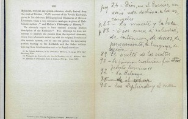
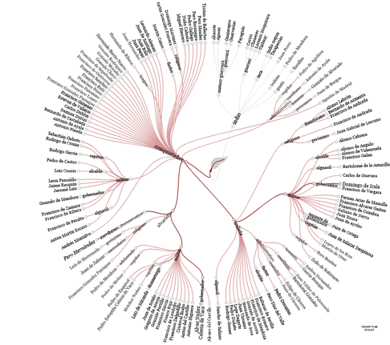
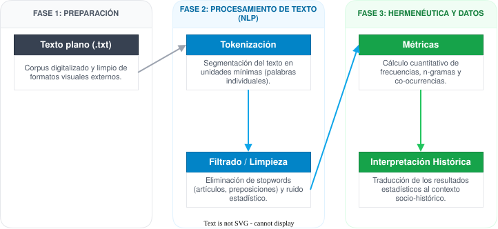
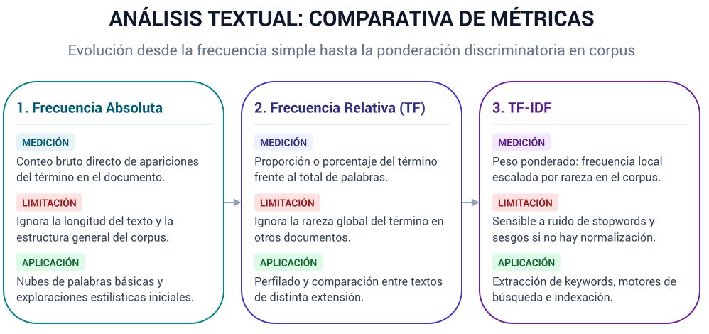

## Explorando corpus con R: las palabras en acción

### Del documento al análisis textual estadístico

##### [Romina De León](mailto:romideleon@gmail.com)

  

---

## 1. El análisis textual estadístico

- **Close Reading:** Lectura intensiva / Hermenéutica tradicional
- **Distant Reading:** Lectura distante / Estadística textual
- **Del documento al dato estructurado**

--

  

    
    <em>The Kabbalah de Christian Ginsburg. Con notas manuscritas de Jorge Luis Borges.</em>
  

  
  

    
    <em>Edición digital de Relación de las cosas sucedidas. Pero Hernández, 1545.</em>
  

---

## 2. Aplicación en la investigación histórica y humanística

  

--

#### ¿Para qué cuantificar el lenguaje del corpus?

- Fijaciones léxicas y énfasis discursivos
- Detección de alteridades y voces en el archivo
- Evolución y cambios estilísticos
- Estilometría y atribución

---

## 3. Introducción a las regularidades estadísticas

**El lenguaje no es aleatorio: se rige por distribuciones de probabilidad y regularidades matemáticas**

--

##### Ley de Zipf: Verificación de la relación rango-frecuencia (Sergio Jiménez, Wikimedia)

--

##### Ley de Heaps: Crecimiento del vocabulario en "Guerra y paz" (Lev Tolstói)

  

--

  

---

## 4. Ahora a trabajar
