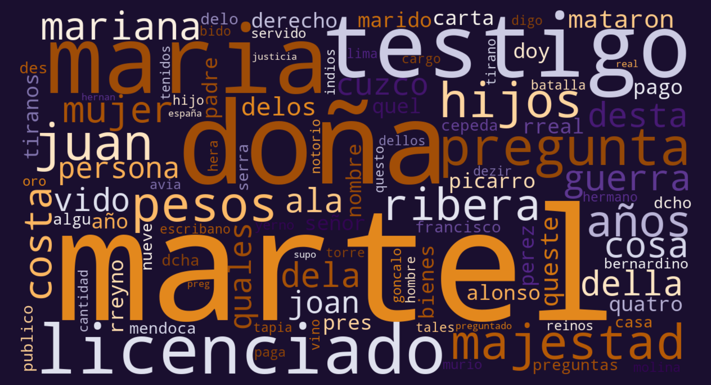
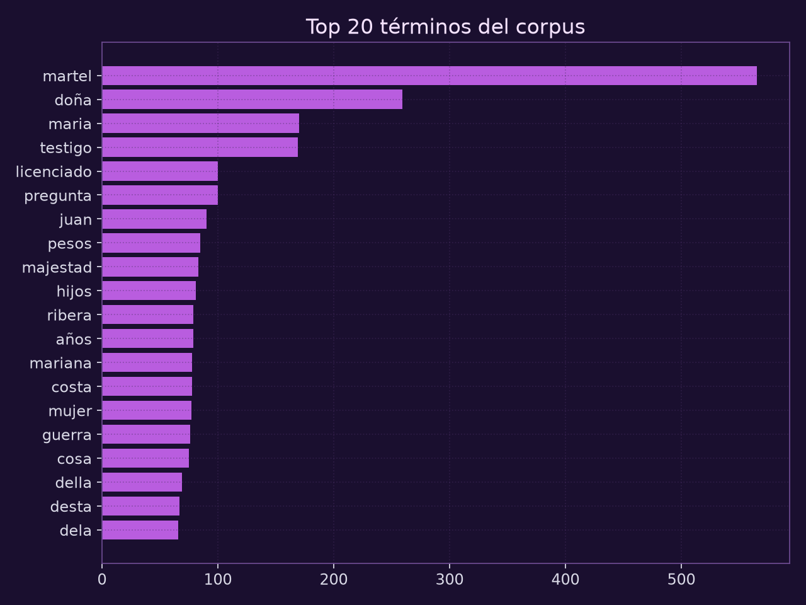
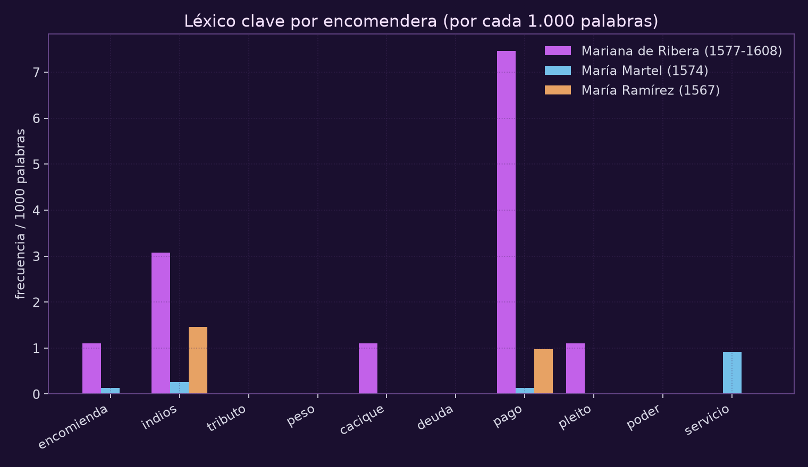
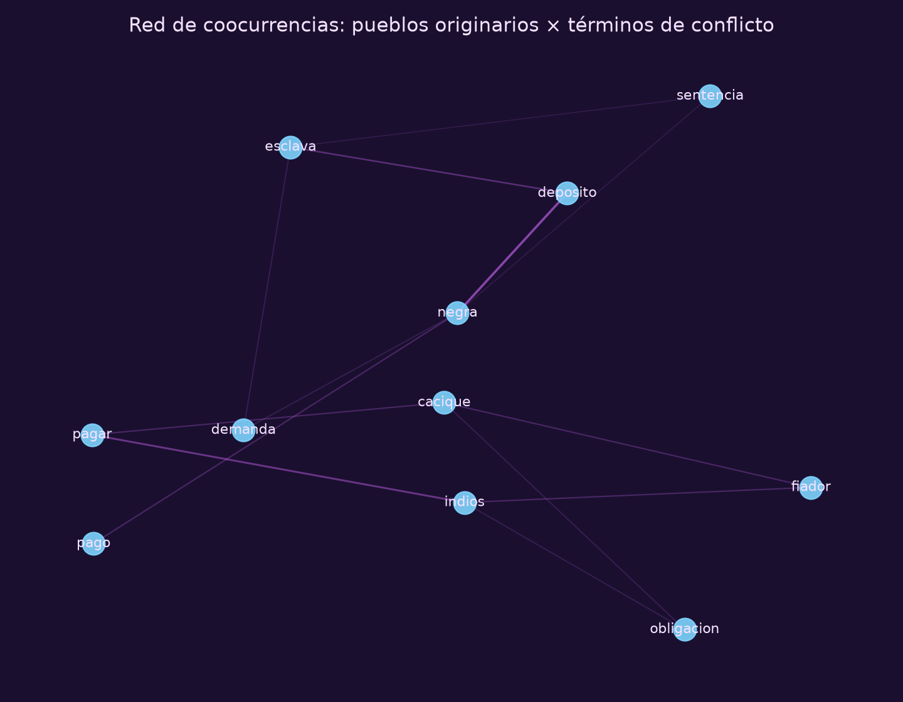

## Voces veladas: Mujeres, Humanidades Digitales y el archivo colonial en los albores del Virreinato del Perú (siglo XVI)

#### Romina De León (HD LAB, CONICET) · [romideleon@gmail.com](romideleon@gmail.com)

###### Congreso Internacional de Humanidades Digitales AAHD 2026 · Viedma · Sesión _Archivos, Patrimonio y Arqueología_

Del proyecto de tesis doctoral (UBA): <i>Encomenderas, mediación y poder en el espacio colonial andino (siglos XVI-XVII)</i> · <b>De la microhistoria a la Historia Digital</b>

  
  

---

## 1. La paradoja del poder femenino colonial

¿Cómo ejerce autoridad **quien ocupa, simultáneamente, una posición de subordinación y una de dominio sociorracial**?

<ul>
  <li><b>Subordinadas</b>: bajo la tutela legal de padres, maridos o albaceas (Mannarelli).</li>
  <li><b>Dominantes</b>: controlaban el trabajo, el tributo y los cuerpos de pueblos encomendados y personas esclavizadas.</li>
</ul>

**Antecedente empírico**: la edición digital y el marcado manual de entidades que reveló la "triangulación legal" de Elvira Manrique de Chaves a través de mediadores varones — la antesala de estas preguntas sobre las encomenderas.

  <a href="https://upload.wikimedia.org/wikipedia/commons/0/04/Criollos-Espa%C3%B1oles_Per%C3%ACodo_Colonial_en_Am%C3%A9rica_%28cropped%291.jpg" data-lightbox="docs">
    
    <em>Criollos y españoles en la sociedad estamental. Felipe Guamán Poma de Ayala, siglo XVI.</em></a>

  <a href="https://www.memoriachilena.gob.cl/602/articles-100512_thumbnail.jpg" data-lightbox="docs">
    
    <em>El corregidor castiga cruelmente a los caciques principales. Guamán Poma de Ayala (1615).</em></a>

<aside class="notes">La pregunta es la directriz del anteproyecto, con su clave "sociorracial" (Lugones: sistema moderno colonial de género). La agencia no es emancipatoria ni anticolonial: es una práctica situada (Mahmood) que negocia y reproduce el orden — voces veladas, no silenciadas: subalternidad archivística (Spivak), porque el archivo no tenía vocabulario institucional para registrarlas.</aside>

---

## 2. Archivo y recorte

- **Archivo General de la Nación del Perú (Archivo Histórico Digital)** y **Archivo General de Indias (Sevilla)**: informaciones de oficio y parte, protocolos notariales de Lima (pagos, obligaciones, depósitos, poderes) — la fase de consolidación y disputa de la **perpetuidad** de la encomienda (1560–1620).
- **Tres encomenderas documentadas entre 1567 y 1608**: María Ramírez, María Martel y Mariana de Ribera.
- **Proyección comparada hacia el sur** del virreinato (Tucumán, Paraguay, Córdoba): la _asincronía regional_ de la encomienda de servicio personal como dato analítico.
- Corpus depurado: **solo transcripciones revisadas** (HTR con Transkribus + cotejo manual) integran el análisis.

  
  
  

<aside class="notes">Subrayar la doble naturaleza del corpus: documentos biográfico-probatorios (informaciones) y documentos económicos (protocolos notariales). Esa diferencia de género documental reaparece en los resultados. Y la tesis del anteproyecto: la documentación tiene opacidad constitutiva, en documentos que se estructuran en clave masculina ("yo conquistador", Dussel) — por eso la evaluación debe computar lo que el archivo no dice.</aside>

---

## 3. Del manuscrito al dataset

**Del papel al texto**

- Paleografía manual + **HTR con Transkribus** + cotejo con la imagen.
- Se excluyen las transcripciones sin revisar: **la calidad de los datos es parte del método**.
- `docx → txt` → tibble ordenado **párrafo por párrafo**, con metadatos trazables.

**El corpus en números**

- <b>6.316</b> párrafos anotados
- <b>23.823</b> tokens · <b>6.941</b> formas únicas
- <b>12</b> documentos · <b>3</b> encomenderas
- Cada párrafo conserva: archivo, tipo documental, marcadores de <b>conflicto</b>, <b>pueblos originarios</b>, <b>sentimiento</b> y entidades.

Pipeline en Python: python-docx, pandas, diccionarios de normalización propios; exportación a CSV reutilizable (R, Gephi, QGIS).

<aside class="notes">La unidad de análisis no es el documento sino el párrafo: eso permite comparar géneros documentales y detectar fisuras dentro del mismo expediente. La delegación parcial de la lectura a las máquinas habilita la lectura simultánea de múltiples archivos y la detección de recurrencias sintácticas y patrones relacionales a otra escala.</aside>

---

## 4. Normalizar el español del siglo XVI

[f3] mancomunidad obligamos nuestras perssonas e bienes sa[bidos¿] e por aver e damos poder a las justicias de su Majestad para su execuçion e [cumplimiento??] ... e por la <b>dha doña Mariana de Rribera</b> e rrenunçia al benefi- cio [?feliano..?]

→ mancomunidad obligamos perssonas bienes sabidos aver damos justicias majestad execucion ... doña mariana ribera rrenuncia ...

- Diccionario de **arcaísmos y abreviaturas notariales** (fazer→hacer, dha→dicha, ſ→s, ç→c) y expansiones de los corchetes editoriales de Transkribus (`[...]` lectura confirmada, `[...¿?]` lectura dudosa).
- Límite honesto: la transcripción no es una operación **neutral ni meramente técnica** — exige decisiones exegéticas rigurosas. Las grafías inestables (_rrenuncia_) y la ortografía variable (_Bernardino / Bernaldino_) quedan documentadas, no silenciadas.

Minimal computing: herramientas abiertas de bajo costo, formato real portable y reproducible — coherente con las infraestructuras académicas de la región.

<aside class="notes">El ejemplo es real (depósito de deuda de Mariana de Ribera): muestra los apoyos de Transkribus, la expansión editorial y el paso del léxico al texto computable.</aside>

---

## 5. El corpus en números

  
<h2 style="margin:0;">12</h2>documentos

  
<h2 style="margin:0;">6.316</h2>párrafos

  
<h2 style="margin:0;">23.823</h2>tokens

  
<h2 style="margin:0;">6.941</h2>formas únicas

Nube de términos del corpus completo (sin stopwords normalizadas, palabras de más de 2 letras).

<aside class="notes">La nube ya anticipa dos hallazgos: la cadena de nominación (doña, María, Martel: los nombres propios dominan el corpus) y los polos temáticos: majestad, guerra, hijos, costa.</aside>

---

## 6. Frecuencias y cadenas de nominación

Top 20: <b>martel (565)</b>, doña (259), maria (170), <b>testigo (169)</b>, licenciado (100), <b>pregunta (100)</b>, pesos (85), majestad (83), mujer (77), guerra (76)…

Los <b>bigramas</b> confirman el molde documental: <i>doña María (136), María Martel (80), Mariana Ribera (70), licenciado Martel (36), queste testigo (35)</i>.

La voz de las encomenderas rara vez habla "en propio": llega siempre <b>mediada por la fórmula notarial</b>.

<aside class="notes">La fórmula (doña + nombre, testigo, pregunta) es un hallazgo en sí misma: la voz de la mujer llega filtrada por la notaría. De ahí el título: voces veladas.</aside>

---

## 7. Tres perfiles léxicos de agencia

- **Mariana de Ribera (1577–1608)**: perfil notarial-financiero — _pago_ (7,5 por mil), _encomienda_, _cacique_, _pleito_.
- **María Martel (1574)**: perfil probatorio — _servicio_ (0,9 por mil) en su información de oficio y parte.
- **María Ramírez (1567)**: _indios_ (1,5 por mil) y _pago_ (1,0 por mil) — crédito y encomendados.

Frecuencia por cada 1.000 palabras, normalizada para comparar documentos de distinto tamaño.

<aside class="notes">Un mismo léxico notarial registra la agencia femenina con acentos distintos: crédito (Ribera), mérito y servicio (Martel), encomendados (Ramírez). Es la evidencia para una lectura relacional del poder femenino.</aside>

---

## 8. La aritmética de las voces veladas

| Tipo documental                                           | Párrafos | % con términos de conflicto |
| --------------------------------------------------------- | -------: | --------------------------: |
| Informaciones de oficio y parte (Martel)                  |   ~3.800 |                       0,2 % |
| Información de oficio y parte (Ramírez)                   |   ~1.430 |                   0,3–0,4 % |
| Cuaderno notarial (Ribera)                                |   ~1.046 |                   5,1–5,2 % |
| Pago / Depósito / Obligación, documentos sueltos (Ribera) |       16 |                    50–100 % |

- El escaso 1,2 % global de párrafos con conflicto **se concentra** en los géneros de crédito: ahí la encomendera aparece como fiadora, deudora y depositaria.
- La casi ausencia de tensión en las informaciones también es dato: el mérito se narra en **fórmulas consagradas**.

<aside class="notes">Un pago de 1577 es 100 % conflicto en su vocabulario: el conflicto no es anomalía, es un subgénero del archivo notarial comparado con el género probatorio.</aside>

---

## 9. Red de coocurrencias: la textura de la coerción

Coocurrencia párrafo a párrafo: pueblos originarios × términos de conflicto (NetworkX).

Aristas dominantes:

<ul>
  <li><b>negra ↔ depósito</b> (7) · <b>esclava ↔ depósito / demanda</b> (4)</li>
  <li><b>pagar ↔ indios</b> (5) · <b>fiador ↔ indios</b> (3)</li>
  <li><b>cacique ↔ fiador / pagar</b> (3)</li>
</ul>

El eje central de la vida cotidiana de la encomienda: <b>personas esclavizadas y pueblos originarios atravesados por el crédito</b>; no aparece "violencia" en el léxico, aparece economía.

Corresponde al <b>eje descendente</b> del anteproyecto: la "dimensión ascendente" (vínculos con pares de la élite, administración regia y local, justicia) la iluminará la red completa del corpus doctoral.

<aside class="notes">Red chica (11 nodos, 13 aristas) pero legible: la coerción no se nomina con palabras de violencia sino de transacción: pago, depósito, fiador. Eso es exactamente "voces veladas".</aside>

---

## 10. Conclusiones ⏱ 45 s

- Las encomenderas del XVI sostuvieron y reprodujeron relaciones de dominación **desde los márgenes legales**: el crédito, el depósito y la fianza —no la fórmula épica— son sus escenarios de agencia.
- El **género documental media la agencia**: la detección de "conflicto" (de 1,2 % a 100 %) depende más del tipo de pieza que del actuar de las mujeres: el archivo disciplina lo decible.
- Lo que se produce no es _data_ sino **capta** (Drucker): los diccionarios de arcaísmos y de tensión son también interpretación historiográfica y exigen crítica, no solo cómputo.
- **Próximos pasos**: marcado **TEI-XML** (minimal computing: portabilidad y sostenibilidad) y redes completas (Gephi / Sigma.js) para escalar de 3 casos al corpus doctoral: más encomenderas, pleitos y testamentos. Historia digital, no solo historia _por_ medios digitales (Noiret).

##### ¡Gracias! · [romideleon@gmail.com](romideleon@gmail.com)

Deck: Reveal.js + Markdown · Cálculos: Python / pandas · Corpus: Transkribus (HTR) + transcripción y revisión manual.

<aside class="notes">Cierre conectado con las otras tres ponencias de la sesión: edición digital, manuscrito árabe y archivo fotográfico comparten la pregunta por qué se vuelve visible, y qué se hace callar, en el aparato documental.</aside>
